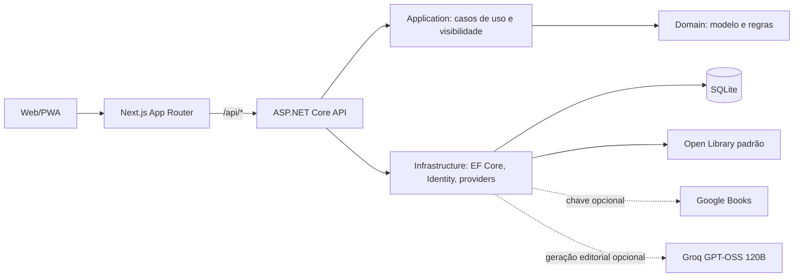
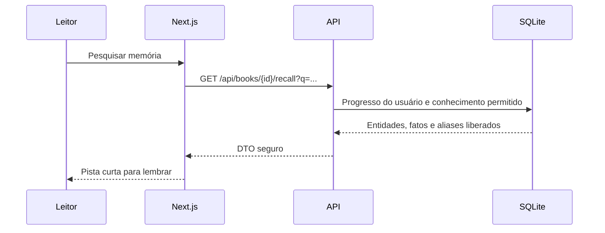

# Arquitetura do Mnemora

A aplicação é um monólito modular. A API autentica, valida entrada, autoriza e retorna DTOs. A Application coordena consultas, normalização de ISBN e a política de visibilidade. A Domain define entidades e invariantes. A Infrastructure persiste dados, implementa Identity e combina providers externos de metadados. A Open Library funciona sem chave; o Google Books participa quando `GOOGLE_BOOKS_API_KEY` está configurada. Uma falha parcial preserva os resultados do provider que respondeu. A composição elimina duplicatas por ISBN-13, ISBN-10 ou, sem ISBN válido, provider/ID.

A busca guarda somente resultados externos públicos no `IMemoryCache` por quatro horas. Esse cache é local ao processo e não contém sessão, biblioteca ou progresso. Não há cache distribuído nem cache de dados privados.

O catálogo distingue packs curados, livros importados e livros privados. Um resultado externo preserva a identidade devolvida pelo provider e, quando existem dados específicos de edição, usa essa edição em vez de misturá-la com os dados gerais da obra. O par provider/ID permite reutilizar a importação entre leitores; um cadastro manual pertence somente ao usuário que o criou. Antes da importação, o frontend apresenta uma confirmação somente leitura com os metadados que distinguem a edição. O registro compartilhado não recebe alterações particulares do leitor.

O modelo persiste título, subtítulo, autor, capa, ISBN-10/ISBN-13, editora, data de publicação e idioma. Página total, categorias e rótulo de edição existem apenas na busca e na confirmação. Descrições e sinopses eventualmente devolvidas pelos providers são descartadas antes do DTO e nunca são persistidas como catálogo ou lore.

Índice de leitura e lore possuem ciclos editoriais independentes (`None`, `Draft`, `Published`). `readingOutlineAvailable` exige índice publicado e ao menos uma unidade; `memoryPackAvailable` exige também lore publicado e ao menos uma entidade. Assim, um livro pode liberar a seleção de capítulos enquanto personagens, facções, lugares, eventos e relações ainda estão em preparação. A API expõe o estado público `Unavailable`, `Requested`, `Preparing` ou `Available` e registra no máximo uma solicitação por usuário e livro compartilhado.

A Open Library continua sendo uma fonte de metadados e, somente para uma edição exata, pode oferecer um `table_of_contents` opcional. O Admin revisa essa prévia antes de importá-la como rascunho de unidades, com hierarquia, ordem estável, rótulos neutros, URL de origem e atribuição. A integração não transforma descrições, assuntos ou outros textos externos em lore. Personagens, relações, eventos e pontos de revelação continuam sob curadoria humana.

`UserBook` é a raiz do estado pessoal de acompanhamento. Uma única atualização pode gravar status, unidade e página depois de validar o payload completo; unidade nula produz `CurrentOrder = null` e volta a ocultar todo lore. Remover um livro usa uma transação para apagar o `UserBook`, as `UserNote` e as `UserRecallActivity` apenas daquele usuário. O `Book` compartilhado permanece no catálogo; um livro privado do proprietário só pode ser eliminado quando estiver órfão e sem unidades ou lore.

O navegador solicita `/api` na mesma origem do frontend. Cookies HttpOnly não são lidos por JavaScript. Mutação requer token antiforgery; a API restringe CORS e aplica `no-store` a conteúdo autenticado. O Next.js entrega a landing pública e o app responsivo; telas privadas fazem leitura pela API sem cache compartilhado.

A [geração assistida](assisted-generation.md) usa um armazenamento temporário próprio na memória do backend, isolado por Admin. O serviço revalida edição e destino vazio, controla revisão e cursor e envia ao Groq apenas o resumo corrente e entidades/aliases já conhecidos. Um montador determinístico verifica citações e acrescenta itens com revelação na unidade corrente. Documento v1 e relatório de evidências são artefatos separados; nenhuma etapa de geração grava lore, fontes ou jobs no SQLite. A importação existente revalida o documento em transação e cria um rascunho. O provedor não recebe ferramentas, segredos de configuração ou capacidades de publicação. A implantação assume uma instância para coordenar sessões e consumo.

