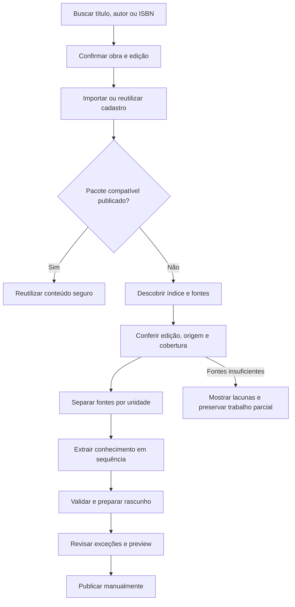

# Automação da adição de livros e preparação editorial

Evolução após as fases 18–22 e o primeiro teste real com Groq. **Fases 23–25 implementadas:** importação de edições no Admin, descoberta bibliográfica e coleta narrativa por capítulo do Wikibooks para os três primeiros Harry Potter, entregue diretamente à geração atual. A coleta é temporária, exige correspondência da edição e preserva lacunas; não há pesquisa web genérica. As fases 26–28 continuam propostas. A prioridade é reduzir o cadastro manual e a coleta de fontes pelo Admin. O orçamento anterior de API zero continua valendo; não habilitar fornecedores ou fallbacks pagos.

## Experiência pretendida

O leitor procura título, autor ou ISBN, confirma a edição e adiciona o livro. Se existir um pacote publicado compatível, ele é reutilizado. Se faltar conteúdo, uma solicitação deduplicada entra na preparação editorial, sujeita às regras de habilitação, concorrência e consumo do serviço.

O Admin procura o livro na mesma integração de catálogo e usa **Adicionar e preparar**. O sistema importa os metadados, descobre sumário e fontes narrativas, confere a correspondência, organiza as fontes por unidade e monta um rascunho. O Admin recebe um resumo de cobertura, fontes, conflitos e itens que precisam de revisão. O caminho normal não deve exigir copiar capítulos, exportar JSON ou editar o arquivo manualmente. Transferência JSON e entrada em lote continuam como ferramentas avançadas e alternativas.

A geração prepara o rascunho; a publicação manual permanece. Essa mudança de experiência não autoriza inventar dados, publicar automaticamente ou mostrar rascunhos ao leitor.

## Base existente e mudanças necessárias

| Área atual | Evolução necessária |
| --- | --- |
| O leitor já pesquisa em Open Library e Google Books opcional | Reutilizar busca e confirmação de edição no Admin |
| O Admin cria livro curado somente com título e autor | Adicionar importação externa administrativa sem criar um vínculo na biblioteca pessoal |
| Importação externa está dentro de `LibraryEndpoints` | Extrair um serviço compartilhado de importação/idempotência, sem duplicar as regras |
| A composição de providers elimina duplicatas | Acrescentar enriquecimento por campo com procedência, preservando valores conflitantes para revisão |
| Open Library pode fornecer sumário da edição | Integrar a descoberta ao preparo, sem importar unidades antes de a geração estar pronta |
| A geração recebe resumos colados | Acrescentar descoberta, leitura e segmentação de fontes; reaproveitar a extração incremental |
| Sessões são temporárias e dirigidas pela página | Separar trabalho de preparação do navegador e planejar retomada com armazenamento durável |
| O importador aceita um livro editorialmente vazio | Montar o rascunho fora das tabelas editoriais e importar uma vez; não quebrar o gate com um índice previamente importado |
| O contrato JSON v1 e o relatório já funcionam | Mantê-los como saída e evidência, sem expor o arquivo como etapa obrigatória ao usuário |

## Fontes e usos

| Fonte | Uso proposto | Limite editorial |
| --- | --- | --- |
| Open Library | Título, autoria, capa, ISBN, edição, idioma, editora, datas e sumário quando disponível | Uma obra agrega edições diferentes; sumário da obra ou de outra tradução não comprova a sequência da edição escolhida |
| Google Books, quando configurado | Complementar identificação e campos bibliográficos ausentes | Sinopse e links de acesso não fornecem, por si só, evidência narrativa por capítulo |
| Wikidata | Relacionar identificadores, títulos alternativos e páginas relacionadas à obra | Dados gerais e relações entre entidades não determinam o capítulo de revelação |
| Wikipedia e wikis com API/documentação e uso permitido | Descobrir páginas relacionadas e candidatos a fontes narrativas | Um artigo de personagem pode conter o desfecho; não usar biografia geral para preencher sua apresentação inicial |
| Wikisource e outras fontes abertas ou autorizadas com estrutura por unidade | Obter texto/índice para extração a partir das unidades identificadas | Conferir versão, idioma e divisão da obra; disponibilidade varia por livro |
| Páginas públicas fora das APIs | Ler páginas descobertas e permitidas de editoras, autores e outras fontes identificadas | Acesso público não equivale a permissão irrestrita de reprodução; registrar origem e condições de uso |
| Fonte fornecida pelo Admin | Resolver cobertura ausente ou edição não identificada | Alternativa para exceções; não requisito do caminho automatizado normal |

Referências verificadas: [Open Library Work/Edition/Books API](https://openlibrary.org/dev/docs/api/books), [Google Books Volume](https://developers.google.com/books/docs/v1/reference/volumes), [Wikidata Data access](https://www.wikidata.org/wiki/Wikidata:Data_access), [MediaWiki Search](https://www.mediawiki.org/wiki/API:Search) e [TextExtracts](https://www.mediawiki.org/wiki/Extension:TextExtracts).

## Papel da IA e da busca

São etapas diferentes: **descobrir fontes → obter os documentos → delimitar unidades → extrair candidatos → verificar evidências → montar o pacote**. A IA pode sugerir consultas, reconhecer estruturas de capítulos e organizar evidências, mas não deve preencher lacunas com memória própria do livro. O backend decide quais ferramentas, destinos e documentos podem ser usados.

Uma fonte com capítulo explicitamente identificado pode sustentar um ponto de revelação depois da conferência de correspondência. Uma sinopse geral, personagem de wiki ou resumo retrospectivo fica como material editorial sem revelação comprovada. Não atribuir capítulo 1, último capítulo ou um capítulo estimado para conseguir publicar esse material.

O [Browser Search do Groq](https://console.groq.com/docs/tool-use/built-in-tools/browser-search) existe para GPT-OSS, mas não é compatível com Structured Outputs. Portanto, não basta acrescentá-lo à chamada atual com schema estrito. A pesquisa deve ser uma etapa separada, com resultados e limites próprios; a extração atual continua recebendo fontes delimitadas e verificáveis. Não presumir que ferramentas de busca estejam incluídas na franquia gratuita apenas porque a inferência usa Groq Free. A busca web geral só deve ser habilitada depois de verificar disponibilidade, cobrança e limites da conta. APIs públicas e descoberta por links permitidos são a base inicial sem um novo serviço pago.

Registrar fornecedor, URL, página/revisão, atribuição, idioma, data de obtenção, hash e vínculo à unidade. Deduplicar fontes e candidatos sem perder procedência. Registrar conflitos em vez de escolher silenciosamente uma tradução, nome, edição ou afirmação. A evidência acompanha o item no relatório, fora do v1.

## Antisspoiler e revisão

- Manter descoberta bibliográfica separada de extração narrativa. Resumos gerais podem ajudar a localizar fontes, mas não entram como contexto de capítulos iniciais.
- Cada chamada de extração recebe apenas a fonte corrente e o registro já conhecido. Conhecimento descoberto para capítulos futuros não contamina apresentações anteriores.
- Conferir também o contexto do parágrafo, não somente uma citação curta que pode ter removido palavras como “suspeita” ou “sem prova”. O primeiro teste real mostrou que uma relação baseada em suspeita pode exigir correção editorial mesmo quando a citação existe.
- Apresentar candidatos descartados, aliases não sustentados, divergências e unidades sem fonte de modo acionável. Cobertura de processamento não é garantia de completude do conhecimento.
- Preservar apresentações congeladas, personas separadas e pontos de revelação controlados pelo backend. Não usar uma chamada final para reescrever todo o livro.
- Importar somente rascunho validado e revisar no preview. O leitor recebe apenas as projeções já publicadas e permitidas pelo progresso.

## Operação e limites

Uma preparação deve ser única por edição/destino, com estados de descoberta, coleta, geração, pausa por quota, revisão e conclusão. A consulta de progresso não faz trabalho novo nem repete chamadas por si só. Repetição de solicitação deve reutilizar o trabalho; cada etapa registra seu resultado e pode ser retomada sem duplicação.

O worker de preparação só pode consumir IA conforme configuração administrativa explícita e cotas globais. Um leitor não recebe capacidade de passar prompts, escolher ferramentas, alterar modelos, definir URLs arbitrárias ou disparar consumo ilimitado ao adicionar livros. Sessões, fontes e diagnósticos administrativos ficam protegidos por posse/role; notificações ao leitor não incluem conteúdo futuro.

O leitor HTTP deve limitar domínio/destino permitido, redirects, tempo, bytes, número de páginas, profundidade de links e tipos de conteúdo. Bloquear loopback, redes privadas e endpoints de infraestrutura, inclusive após resolução de DNS e redirects. Usar identificação do aplicativo, cache de fontes públicas, rate limits e `Retry-After`. Fontes são dados não confiáveis, sem autorização para executar instruções ou acessar segredos.

A geração atual limita 64 unidades, duas horas e 180 mil tokens por sessão. Livros maiores exigem execução em lotes com estado e ordem preservados, possivelmente em dias diferentes conforme a quota; não resolver cortando capítulos, esquecendo entidades anteriores ou aumentando limites silenciosamente. Documentos longos também precisam ser divididos dentro da unidade sem receber texto de unidades posteriores. O teto global de consumo deve continuar valendo entre trabalhos.

Durabilidade requer persistência das etapas, revisões e fontes autorizadas, com retenção limitada. Isso é uma evolução do modelo atual, que deliberadamente não criou migrations. Não apresentar o SQLite efêmero do Render Free como armazenamento durável: suspensão/redeploy pode apagar banco e jobs, e o serviço suspenso não continua processando. A estratégia de hospedagem/persistência deve ser definida antes de prometer execução contínua em produção; não contratar serviços pagos automaticamente.

## Fases entregues e propostas

Cada fase mantém a regra do projeto: verificar o que mudou, revisar diff/segredos, commit e push para `origin main`; resolver falha de push antes da seguinte.

| Fase | Entrega | Aceite principal |
| --- | --- | --- |
| 23 — Cadastro por busca no Admin | Busca por título/autor/ISBN, confirmação da edição, importação administrativa e serviço compartilhado | Cadastro automático dos metadados disponíveis; repetição reutiliza o livro; nenhuma associação pessoal ou lore inventado; sem regressão no leitor |
| 24 — Descoberta de fontes | Resolver identificadores, consultar fontes públicas e apresentar cobertura/procedência | Candidatos correspondem à obra/edição ou ficam marcados como ambíguos; dados gerais nunca viram lore liberado |
| 25 — Coleta e organização por unidade | Ler fontes permitidas, conferir índice, segmentar e alimentar o extrator atual | Evidências preservadas; ordem correta; sinopse geral e suspeita fora de contexto não viram revelação; lacunas visíveis |
| 26 — Orquestração retomável | Estados/etapas persistidos, worker limitado, deduplicação, pausa por quota e cancelamento | Fechar a página não perde o progresso em armazenamento durável; nenhum consumo duplicado; limites e ambiente efêmero tratados explicitamente |
| 27 — Preparação integrada | “Adicionar e preparar”, revisão por exceções, rascunho automático e reaproveitamento de pacote publicado | Caminho normal sem colar resumos/exportar JSON; revisão e publicação continuam explícitas; livro preenchido nunca é sobrescrito |
| 28 — Avaliação e entrega | Livros reais representativos, fontes, qualidade, custo operacional e regressões | Relatório distingue dados encontrados, inferências rejeitadas e lacunas; fronteiras, Recall, timeline, retrocesso e autorização preservados |

Operação entregue da fase 24: [descoberta de fontes públicas](source-discovery.md). Ela consulta APIs fixas, apresenta candidatos e não coleta texto de artigos, não preenche fontes do gerador e não cria conteúdo editorial.

Operação entregue da fase 25: [preparação automática por capítulo](automatic-sources.md). O coletor usa somente Sinopse/Synopsis em revisões fixadas, não as análises ou links gerais da descoberta bibliográfica. Revisão, importação em rascunho e publicação permanecem manuais. Não há worker durável nem retomada após reinício.

A fase 23 reutiliza uma integração funcional e remove o cadastro duplicado no Admin. A avaliação inicial prioriza os três primeiros livros de Harry Potter, indicados pelo usuário; os resultados e lacunas estão no [levantamento de fontes](harry-potter-source-assessment.md). A avaliação das próximas fases deve contemplar pelo menos um caso com fonte narrativa estruturada e outro com cobertura insuficiente. Ausência de fonte é um resultado esperado e visível, não um motivo para gerar conteúdo sem evidência.
