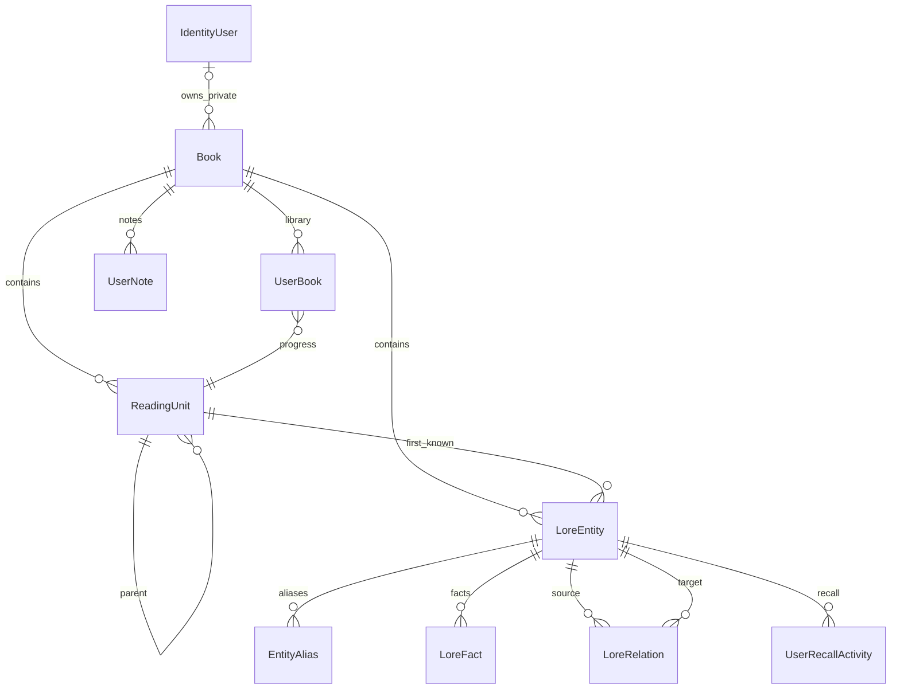

# Modelo de domínio do Mnemora

`Book` é o catálogo de metadados. Ele pode persistir título, subtítulo, autor, capa, ISBN-10, ISBN-13, editora, data de publicação e idioma. `CatalogKind` separa três ciclos de vida: `Curated` para packs editoriais públicos, `Imported` para metadados externos reutilizáveis e `Private` para o cadastro manual de um leitor. Apenas livros privados possuem `OwnerUserId`; outro usuário não pode pesquisá-los, abrir seu detalhe nem adicioná-los à biblioteca. O par `ExternalProvider`/`ExternalId` identifica uma edição importada de forma global e idempotente.

ISBNs passam por uma normalização compartilhada que valida os dígitos e relaciona ISBN-10 e ISBN-13 equivalentes. Na agregação dos providers, ISBN-13 tem prioridade para deduplicar resultados, depois ISBN-10 e, quando nenhum ISBN válido está disponível, provider/identificador. Título e autor não formam uma identidade bibliográfica. Número de páginas, categorias e rótulo da edição ajudam o leitor a escolher um resultado, mas não pertencem ao estado persistido de `Book`. Descrições e sinopses externas não entram no contrato, no DTO ou no estado persistido, porque podem conter spoilers.

`ReadingUnit` representa parte, capítulo ou seção canônica, com `OrderIndex` absoluto por livro, pai opcional e `SafeLabel` não revelador. A existência de ao menos uma unidade indica `MemoryPackAvailable`. Um livro sem pack ainda participa da biblioteca e aceita status, página de referência e notas gerais, mas não libera lore. `UserBook` guarda status, unidade, página e os timestamps de início, última leitura e conclusão; unidade e página podem ser limpas. A página é referência pessoal, e somente `CurrentReadingUnitId` controla o conhecimento quando há unidades.

`LoreEntity` representa personagem, facção, lugar, evento ou outro conceito. Seu nome, resumo inicial e imagem devem ser seguros em `FirstKnownAtUnitId`. `EntityAlias`, `LoreFact` e `LoreRelation` possuem `RevealAtUnitId` próprio. `MemoryHint` pertence a um fato, portanto segue a revelação dele. `ChronologyIndex` ordena eventos conhecidos independentemente da sequência de leitura.

`UserNote` e `UserRecallActivity` pertencem ao usuário e livro. A primeira é privada e pode existir como nota geral mesmo em livros sem pack; a segunda guarda feedback simples de revisão e pode alimentar funcionalidades futuras. Ambas fazem parte da memória pessoal ligada ao `UserBook` e são removidas para aquele usuário quando o livro sai de sua estante.

Remover um vínculo não elimina livros `Curated` ou `Imported`, mesmo quando nenhum leitor restante os referencia. Um `Book` `Private` só pode ser excluído junto com o último vínculo do proprietário quando não possui unidades, entidades, relações nem referências de outra conta. Essa regra conserva o catálogo compartilhado e qualquer conteúdo editorial.

O banco mantém FKs, índices, unicidade de ordem/slug por livro e unicidade do identificador externo. ISBN-10 e ISBN-13 normalizados de cadastros privados são únicos por proprietário, e uma restrição garante que somente livros `Private` tenham dono. Metadados importados são compartilhados, portanto a revisão anterior à importação é somente leitura e não cria variações particulares por usuário. As operações de escrita também validam que pai, entidade, fato, relação e unidade de revelação pertencem ao mesmo livro, e que um fato ou relação não aparece antes das entidades envolvidas. As migrations são versionadas; SQLite é o provider inicial, sem regras de domínio dependentes dele.
